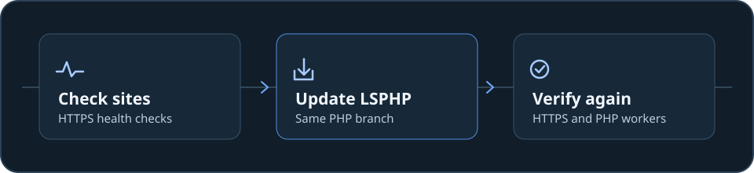

# CyberPanel PHP Security Updater

Update the LiteSpeed PHP packages your sites already use. A site on PHP 8.3 can receive an 8.3 patch while keeping the same PHP selection in CyberPanel.

**CyberPanel + OpenLiteSpeed** · AlmaLinux 8, 9 and 10 · Ubuntu 22.04 and 24.04



| I want to… | Use |
| --- | --- |
| See available PHP updates | `sudo php-security-update --check` |
| Update PHP and check sites every day | [Enable daily updates](#daily-updates) |
| Scan site files for suspicious changes | `sudo php-security-update --security-scan` |
| Review and apply updates now | `sudo php-security-update --secure-update` |

## Install and preview

On a supported server, clone the tool, link its command and run the package preview. The preview lists eligible LSPHP updates and the PHP handlers it can resolve.

```bash
sudo git clone https://github.com/KeygenLTD/cyberpanel-php-security-updater.git \
  /opt/cyberpanel-php-security-updater
sudo chmod 0755 /opt/cyberpanel-php-security-updater/bin/php-security-update
sudo ln -s /opt/cyberpanel-php-security-updater/bin/php-security-update \
  /usr/local/bin/php-security-update
sudo php-security-update --check
```

If the tool is already installed, use `sudo git -C /opt/cyberpanel-php-security-updater pull --ff-only origin main`. The system Python needs DNF4/RPM bindings on AlmaLinux or `python3-apt` on Ubuntu.

## Daily updates

**Turn on per server.** The timer runs daily at **03:00 UTC (06:00 in Türkiye)**. Package changes can start between 03:00 and 04:00 UTC.

1. Check each configured HTTPS endpoint. A failed check blocks package changes.
2. Resolve a signed transaction for installed LSPHP packages and check the configured recovery option. A missing dependency, package removal or downgrade blocks the update.
3. After a package change, request a PHP worker refresh and check HTTPS, OpenLiteSpeed and PHP workers again. Results appear in the system journal.

### 1. Configure sites and the backup

Create `/etc/cyberpanel-php-security-updater/daily.json`, owned by root with mode `0600`.

```json
{
  "https_urls": ["https://example.com/"],
  "backup": "/root/backups/server-backup.tar",
  "backup_sha256": "REPLACE_WITH_THE_BACKUP_SHA256",
  "restore_tested": true
}
```

List a final HTTPS URL returning 2xx for each affected site. An uncached page that exercises PHP is a good target. The updater verifies TLS and does not follow redirects. Keep the backup path and digest current. Set `restore_tested` after testing a restore of the server, including sites, databases, web configuration and package state.

If you manage snapshots in a provider panel, you can replace the three backup-file fields with `"operator_snapshot_confirmed": true`. The journal records the snapshot as confirmed by the operator. The updater does not contact the provider or check the expiry date. Keep your snapshot current while the timer is enabled.

### 2. Enable and check the timer

```bash
cd /opt/cyberpanel-php-security-updater
sudo install -m 0644 systemd/cyberpanel-php-security-update.{service,timer} \
  /etc/systemd/system/
sudo systemctl daemon-reload
sudo systemctl enable --now cyberpanel-php-security-update.timer
systemctl list-timers cyberpanel-php-security-update.timer
sudo journalctl -u cyberpanel-php-security-update.service -n 50 --no-pager
```

To stop future scheduled runs, use `sudo systemctl disable --now cyberpanel-php-security-update.timer`. If the journal reports `transaction_completed: true` alongside an error, packages changed and a follow-up check failed. Check the site before retrying.

## Manual security scan

```bash
sudo php-security-update --security-scan
sudo php-security-update --security-scan --days 30 --interactive
```

The scan looks for web-shell and compromise indicators in site files. Interactive review lets you inspect findings and choose whether to quarantine a file. Daily PHP maintenance does not run the scan.

Repeated scans reuse results for unchanged files, including previous findings. New or changed files are analyzed again. The cache is private to root in `/var/lib/cyberpanel-php-security-updater/scan-cache` and invalidates automatically when the scanner changes. Use `--security-scan --deep` to reanalyze all supported web files regardless of age or cache. Persistence locations keep their configured time window.

## One-off updates

Run `sudo php-security-update --secure-update` to scan files, review findings, preview the PHP package changes, and approve installation. Prepare a restorable backup before approving. Verify the affected sites through their real HTTPS routes after the update.

<details>
<summary>Explicit apply, package policy and reports</summary>

For a one-off update with a verified backup and a maintenance window, use:

```bash
sudo php-security-update --apply \
  --approve APPLY-LSPHP-UPDATES \
  --backup /root/backups/server-backup.tar \
  --backup-sha256 "$BACKUP_SHA256" \
  --restore-tested \
  --window-start "$START_UTC" --window-end "$END_UTC" \
  --report-prefix /root/php-apply
```

Provide UTC timestamps in `YYYY-MM-DDTHH:MM:SSZ` format. The same validated package transaction is applied without a second resolve. Only already-installed LSPHP packages with the same name and architecture can be upgraded. Package signatures or trusted APT metadata are required. Review dependency changes separately. A newer repository version alone does not establish that a particular CVE is fixed.

Use `--json` for machine-readable output and `--report-prefix` to write JSON and text files. Exit code `0` means the requested workflow passed. Exit code `2` means it was blocked, failed or could not be fully verified.

</details>

<details>
<summary>Stale PHP workers and development checks</summary>

After a package update, existing workers can still hold the old PHP executable. The daily mode requests the LiteSpeed worker refresh and reports any stale workers it can still see. The one-off `--terminate-stale` option uses SIGTERM within the approved maintenance window and requires Linux pidfd support. Stock EL8 platform Python lacks that support. During maintenance, use the documented LiteSpeed procedure and verify the live sites afterwards. Keep a tested recovery plan for package or application failures.

```bash
python3 -m unittest discover -s tests -v
shellcheck bin/php-security-update
```

[CI](.github/workflows/ci.yml) includes Linux package transaction tests. See [OpenLiteSpeed detached PHP](https://docs.openlitespeed.org/config/php/detached/) and [PHP support lifecycle](https://www.php.net/supported-versions.php).

</details>
